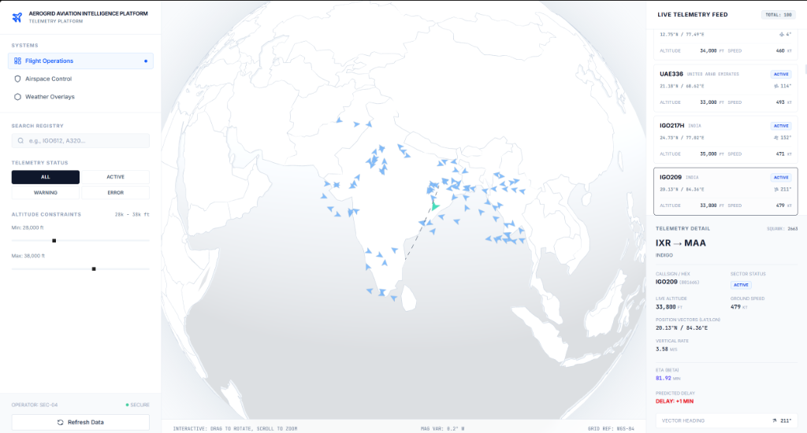
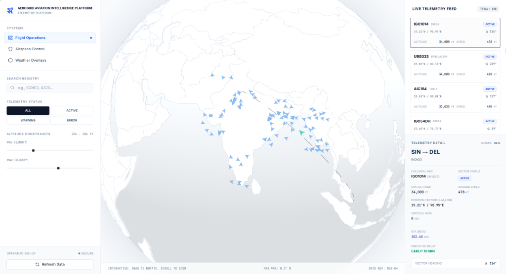

# AeroGrid Analytics


AeroGrid Aviation Intelligence Platform is a comprehensive telemetry and flight operations monitoring system. It provides real-time airspace visualization, telemetry tracking, and machine learning-powered predictions for estimated times of arrival (ETA).




## Architecture Overview

The system is composed of three primary subsystems:

* **Frontend Application (Root)**: A high-performance web interface built with React, TypeScript, and Vite. It features 3D data visualization powered by `react-globe.gl` and `three.js`, and is styled with Tailwind CSS.
* **API Gateway (`/backend`)**: A robust Node.js and Express server written in TypeScript. It handles data routing, client requests, and orchestration between the user interface and the analytics engine.
* **Machine Learning Engine (`/python-ml-service`)**: A scalable FastAPI application running a PyTorch neural network. It calculates precise flight ETAs based on live telemetry features including velocity, altitude, heading, vertical rate, and hub proximity. The model execution is hardware-accelerated via `torch_directml`.

## ETA Prediction Engine

The ETA engine is built as an independent FastAPI microservice.

Input Features:

- Latitude
- Longitude
- Velocity
- Heading
- Vertical Rate
- Altitude
- Airport Distance
- Route Information

Output:

- Predicted ETA
- Remaining Flight Time

Now recruiters immediately understand what the AI does.

## Technology Stack

| Layer | Technologies |
|---|---|
| Frontend | React, TypeScript, Vite, Tailwind CSS |
| Visualization | react-globe.gl, Three.js |
| Backend | Node.js, Express, TypeScript |
| Machine Learning | FastAPI, PyTorch, scikit-learn |
| APIs | OpenSky, AirLabs |

## External APIs

* **OpenSky Network**

Provides live ADS-B flight telemetry including:

- Position
- Velocity
- Heading
- Altitude
- Vertical Rate

Shows aviation knowledge.
* **AirLabs API**: Supplies comprehensive flight route data including origins, destinations, airline information, airport coordinates, and estimated arrival schedules.

## Development Setup

To run the platform locally, you will need to initialize each of the three subsystems.

### Prerequisites

* Node.js (v18 or newer)
* Python (3.9 or newer)
* npm

### 1. Client Interface (Frontend)

From the repository root, install dependencies and start the Vite development server:

```bash
npm install
npm run dev
```

### 2. API Gateway (Backend)

Navigate to the backend directory, install the required packages, and launch the server:

```bash
cd backend
npm install
npm run dev
```

*Note: Ensure you configure the `.env` file based on the provided `.env.bak` template before starting the server.*

### 3. ML Analytics Engine

Navigate to the Python service directory and configure the environment:

```bash
cd python-ml-service
python -m venv venv
```

Activate the virtual environment (Windows: `venv\Scripts\activate`, Unix: `source venv/bin/activate`) and install the necessary dependencies (FastAPI, PyTorch, scikit-learn, pandas).

To start the inference server:

```bash
fastapi run main.py
```

*Note: The service requires the pre-trained `eta_model.pth` and `scaler.pkl` artifacts. If these are missing, you must generate them by running `python train.py` with the appropriate dataset.*

## Core Features

* **Flight Operations Dashboard**: Real-time monitoring of active flights with advanced filtering by altitude constraints, telemetry status, and flight registry.
* **Predictive Analytics**: Neural network-driven ETA calculations processing multidimensional flight telemetry.
* **Hardware Acceleration**: Deep learning inference optimized for AMD compute architectures via DirectML.

## License

Proprietary Software. All rights reserved.